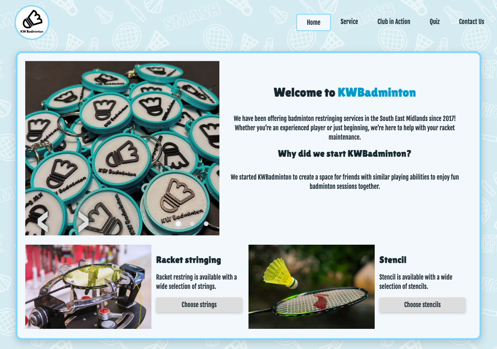

# KW Badminton – Racket Stringing Service

A front-end-only website for a badminton club's racket-stringing and stencil service, built with plain HTML, CSS and JavaScript.

This was coursework for the MSc module **INM316 Web Design and Development**. It was originally built on Glitch.com and later moved to GitHub and Netlify.

Live site: https://kwstringingservice.netlify.app/



## Pages

- `index.html` – homepage with photo carousel and service overview
- `stringAndStencil.html` – Services page with Strings / Stencils tabs (string cards are built from `strings.json` by `addStringsToPage.js`)
- `clubInAction.html` – club photo feed
- `quiz.html` – badminton quiz
- `contactUs.html` – contact form and map

Images are in `images/`.

## Running locally

No build step or dependencies. Serve the folder with any static web server. Opening the files directly (`file://`) won't work because the Services page loads `strings.json` with `fetch`. For example:

```bash
python3 -m http.server 8000
```

Then open http://localhost:8000.
